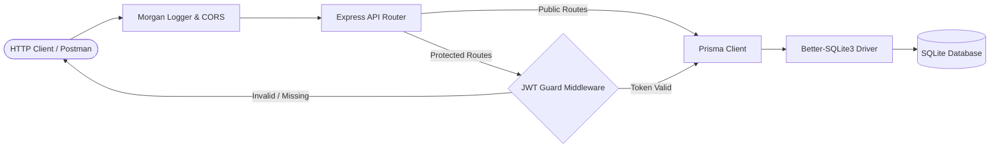
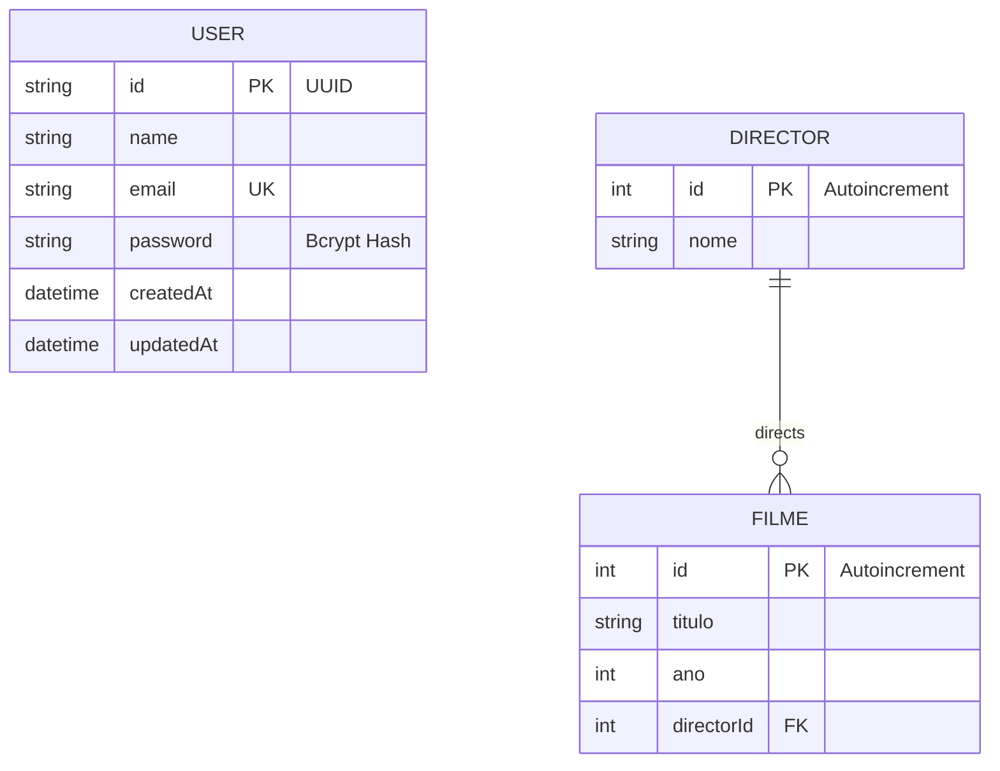

# 🎬 Movie Catalog API

<p align="center">
  
  
  
  
  
  
</p>

A RESTful movie and director catalog API built with **Node.js**, **Express**, **Prisma ORM**, and **SQLite**.

It provides user authentication with JWT, relational management of movies and directors, and route aliases in both Portuguese and English.

---

## ⚡ Architecture & Request Flow



---

## 📊 Database Schema (ERD)



---

## ✨ Features

* **User Authentication:** Registration and login endpoints using bcrypt for password hashing and stateless JWT bearer tokens.
* **Movies & Directors CRUD:** Full management of movies linked to directors with relational foreign key validation.
* **Dual-Language Routes:** Endpoints available in Portuguese (`/filmes`, `/directores`) and English (`/movies`, `/directors`).
* **Database & ORM:** Uses Prisma ORM with SQLite for local development and includes a seeder script with sample directors and movies.
* **Postman Collection:** Ready-to-use collection with automated token extraction for protected requests.

---

## 📑 API Endpoints Reference

### 🔐 Authentication

| Method | Endpoint | Access | Description |
| :--- | :--- | :--- | :--- |
| `POST` | `/auth/signup` | Public | Register a new user |
| `POST` | `/auth/signin` | Public | Authenticate & receive JWT token |

### 🎬 Directors (`/directores` or `/directors`)

| Method | Endpoint | Access | Description |
| :--- | :--- | :--- | :--- |
| `GET` | `/directores` | Public | List all directors with their movies |
| `GET` | `/directores/:id` | Public | Get a single director by ID |
| `POST` | `/directores` | 🔒 Authenticated | Create a director |

### 🎥 Movies (`/filmes` or `/movies`)

| Method | Endpoint | Access | Description |
| :--- | :--- | :--- | :--- |
| `GET` | `/filmes` | Public | List all movies with director details |
| `GET` | `/filmes/:id` | Public | Get a single movie by ID |
| `POST` | `/filmes` | 🔒 Authenticated | Add a new movie linked to a director |
| `PUT` | `/filmes/:id` | 🔒 Authenticated | Update movie details |
| `DELETE` | `/filmes/:id` | 🔒 Authenticated | Delete a movie |

---

## 🛠️ Getting Started

### Prerequisites
* **Node.js** v20+
* **npm** v10+

### 1. Clone the repository
```bash
git clone https://github.com/Afonsojlc/movie-catalog-api.git
cd movie-catalog-api
```

### 2. Install dependencies
```bash
npm install
```

### 3. Environment configuration
Copy the template file to `.env`:
```bash
cp .env.example .env
```
Ensure your `.env` contains:
```env
SERVER_PORT=4242
DATABASE_URL="file:./prisma/dev.db"
JWT_SECRET="your_jwt_secret_key"
```

### 4. Database initialization & seed
```bash
# Push Prisma schema to SQLite
npx prisma db push

# Seed sample data (directors, movies, demo user)
npm run seed
```

**Pre-set demo login:**
* Email: `demo@example.com`
* Password: `Password123!`

### 5. Start the server
```bash
# Development (with nodemon)
npm run dev

# Production
npm start
```
The server will run at `http://localhost:4242`.

---

## 📬 Testing with Postman

A Postman collection is included in the root directory: [`movie-catalog-api.postman_collection.json`](movie-catalog-api.postman_collection.json).

1. Import the file into Postman.
2. Run the **Sign In (Login)** request.
3. The test script saves the returned JWT token to the `{{token}}` variable so that subsequent requests authenticate automatically.

---

## 📁 Project Structure

```text
movie-catalog-api/
├── prisma/
│   ├── schema.prisma                  # Prisma data models
│   └── seed.js                        # Database seeder script
├── .env.example
├── .gitignore
├── movie-catalog-api.postman_collection.json
├── package.json
├── server.js                          # Express application and route handlers
└── README.md
```

---

## 👤 Author

**Afonso Carvalho**  
* GitHub: [@Afonsojlc](https://github.com/Afonsojlc)  
* LinkedIn: [Afonso Carvalho](https://www.linkedin.com/in/afonso-carvalho-64796328a/)

---

## 📄 License

This project is licensed under the [MIT License](LICENSE).
